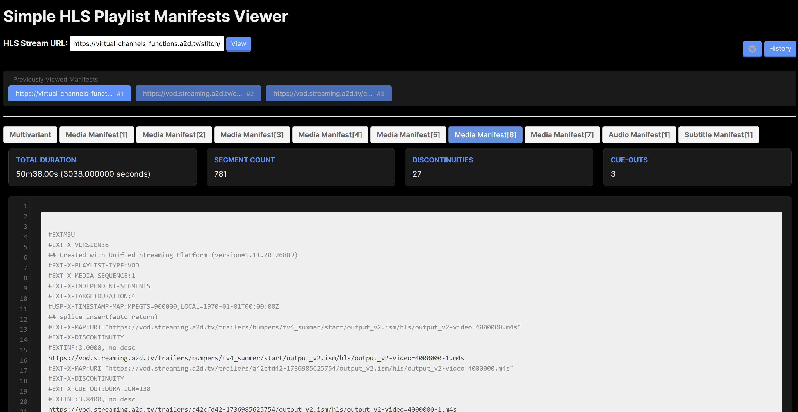

# HLS Manifest Viewer

A lightweight, browser-based inspector for HTTP Live Streaming (HLS) playlists. Paste a master or media playlist URL to explore its related manifests, inspect stream health, and preview selected media segments—without installing an app or running a server.

## Highlights

- Inspect multivariant, video, audio, subtitle, and other `.m3u8` playlists in one place
- See playlist duration, segment count, discontinuities, cue-out/ad-break information, and sequence numbers
- Identify divergent media or discontinuity sequences across live renditions
- Colour segment URLs by their resolved origin and first path segment, making alternate/ad delivery paths easy to spot
- Refresh an individual playlist without refetching the entire stream
- Cancel an in-progress inspection instead of waiting for failed hosts or proxies to time out
- Select media playlist lines to calculate their combined duration or preview selected segments
- Keep a configurable local history of previously inspected URLs
- Create a shareable viewer URL for the current manifest
- Set a main segment origin to improve ad-break identification in specific workflows

## Use it

1. Clone or download this repository.
2. Open [`public/index.html`](public/index.html) in a modern browser.
3. Paste an HTTP(S) URL for a master or media playlist and choose **Inspect stream**.

There is no build step, package manager, server, or account required. The viewer runs entirely in your browser.

## What you will see

| Area | Purpose |
| --- | --- |
| Playlist tabs | Switch between the master playlist and discovered video, audio, and subtitle renditions. |
| Metrics | Review duration, segment count, ad-break count, and sequence information. |
| Manifest panel | Read the raw playlist with line numbers and syntax highlighting. |
| Ad tools | Open the side panel to review detected cue-out intervals. |
| History | Reopen a recent inspection stored locally in your browser. |

## Segment preview

In a media playlist, select one or more segment URI lines (including their `#EXTINF` lines will also show the selected duration). The viewer finds their playlist context and, when supported, opens a small preview player. Drag it by the header, use the seek bar to scrub through the selection, and adjust playback or volume from the controls. It supports TS and fMP4/CMAF segment selections.

## CORS and network access

Browsers only allow the viewer to fetch manifests when the host permits cross-origin requests. The app tries direct fetching and configured public CORS proxies, but a stream may still be unavailable because of CORS policy, authentication, DRM, network rules, or an unavailable proxy.

Use only manifest URLs and streams you are authorised to access. The viewer does not send data to an application backend; its network requests are made by your browser.

## Browser support

Use a current version of Chrome, Firefox, Safari, or Edge. Segment preview relies on browser media support and Hls.js, which is loaded from a CDN.

## Privacy and storage

The viewer stores preferences plus a small URL-and-timestamp history in `localStorage` in the current browser profile; opening a history item fetches the playlist again. Use **Settings → Clear History** to remove stored entries. Shared links contain the manifest URL, so treat them as sensitive if the URL includes a token.

## Dependencies

The interface is static HTML, CSS, and JavaScript. At runtime it loads:

- [jQuery](https://jquery.com/) for DOM interactions
- [Hls.js](https://github.com/video-dev/hls.js/) for compatible segment preview

## Development

Edit `public/index.html` and `public/styles.css`, then refresh the page in a browser. Because this is a static app, no local development server is required. Opening it from a simple local server can still be useful when diagnosing browser security behaviour.

## Security notes

- A Content Security Policy is included in the page.
- User-provided manifest content is HTML-sanitised before display.
- No server-side processing or application database is used.
- External manifests and CDN dependencies remain subject to their own availability and security policies.

## License

Released under the [MIT License](LICENSE).
